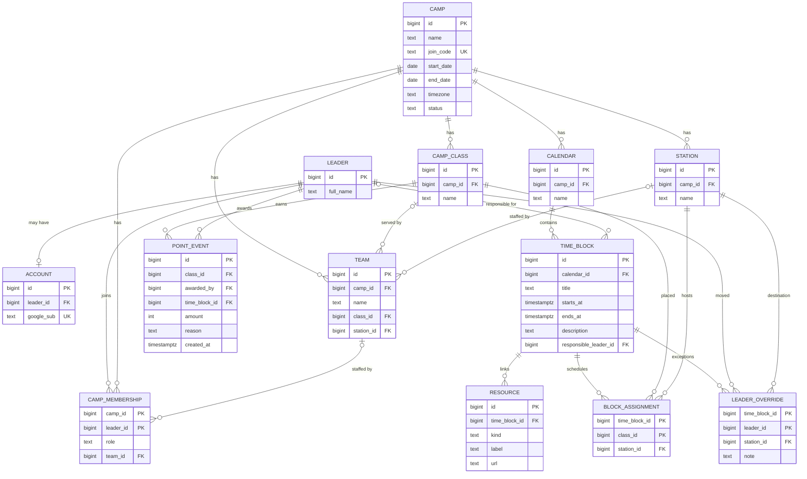

# Camply: reference ER diagram

Renders on GitHub automatically. In VS Code, install the "Markdown Preview Mermaid Support" extension, or paste the block into https://mermaid.live to zoom and pan.

